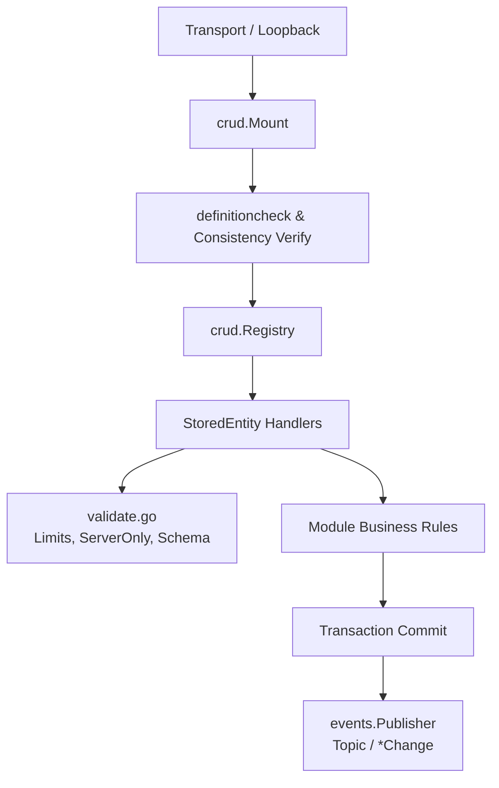

# Architecture

## 1. Overview & Context

`webtyp/crud` provides a standardized, closed execution engine for data operations across domain modules. It serves as the single transactional and validation boundary between transports (`rpc`, `mcp`, `dbsync`, or in-process `Loopback`) and persistence stores (`orm.TenantStore`, `orm.GlobalStore`).

For visual context on how `crud` interfaces with upstream contracts and downstream consumers, see [`docs/diagrams/PLACEMENT.md`](diagrams/PLACEMENT.md).

## 2. Core Abstractions

1. **[`crud.Module`](../contract.go):** The domain module contract. A module declares its entities and rules via `Definition() model.ModuleDefinition` and mounts operations through `MountOperations(crud.Registry)`.
2. **[`crud.Registry`](../contract.go):** The restricted mounting interface passed to modules. Only allows mounting entities via `AddStoredEntity` or read-only wire projections via `AddReadOnlyEntity`.
3. **[`crud.StoredEntity`](../contract.go):** Represents a persistent domain entity. Connects `Store`, declared `model.Rules`, and optional business rules for Create, Update, Delete, or Search.
4. **[`crud.CurrentUser`](../contract.go):** Explicit actor identity containing `UserID` extracted directly from verified session context—never read from request parameters.
5. **[`crud.RuleAnswer`](../result.go):** Typed business rule response (`ApplyAndPublish()` or `ApplyWithoutPublishing()`), optionally requesting external calls. The zero value is refused (`ErrNoAnswer`).
6. **External Calls Orchestration (D58):** Calls declared in `Definition.ExternalCalls` are queued transactionally in `CallQueue` within the write's `tx`. `WaitForReply` runs inline with a timeout; `RetryInBackground` retries with backoff in background; `WaitForConfirmation` waits for provider confirmation via `ConfirmCall` / `RejectCall`. `SetDefaultQueue` allows the composition root (appkit) to provide the queue for `Mount` and `Loopback`.
7. **[`crud/conformance`](../conformance/conformance.go):** Test suite proving an implementation of `crud.Store` satisfies its contract with `conformance.Run(t, newStore)`, concurrency included (one winner among racing creates, unique values and conditional updates). `crud` imports no implementation: each store and each driver runs the suite in its own tests (the `orm` store over `storage/mem` in `orm`, over a real database in the driver's tests).

## 3. Execution & Data Flow

For details on write operation progression, see [`docs/diagrams/WRITE_FLOW.md`](diagrams/WRITE_FLOW.md).

- **Transactional Boundaries:** A write of one record with no business rule runs without a transaction (a single statement is atomic by itself). All other writes and any operation with a business rule execute inside atomic transactions via `inTransaction(Store, fn)`: a rule always gets a transaction so its check and write remain one atomic unit. If any record or hook fails, the entire transaction rolls back.
- **Post-Commit Publishing:** Events are published **strictly after the transaction commits**, never inside. This eliminates ghost events caused by rollbacks or connection drops during commit.
- **Event Notification:** Published via `events.Publisher` using canonical topics formatted by `crud.Topic(module, entity, action)` (e.g. `patients.patient.created`) carrying a `*crud.Change` payload with the stored record and touched update fields.
- **Queries and Limits:** Read queries enforce `Cap(limit)` bounded by `MaxPage` (500). Pagination cursors operate through stable primary key ordering.
- **Optimistic Concurrency & Revision (D48):** For entities declaring a `Revision` field, `create` initializes the revision counter to 1. On `update`, the revision field is immutable from client payloads (`ErrInvalidField`); the client passes the read revision in the record carrier (`Record.Revision > 0`). `crud` increments the counter, appends it to fields, and updates conditionally via `ConditionalUpdater.UpdateFieldsIf`. Stale concurrent updates fail with `ErrConflict` (409). Duplicate key errors map to `ErrAlreadyExists` (409).

## 4. Cross-Cutting Concerns

- **Startup Consistency Verification:** `crud.Mount` compares the module's declared `Definition()` against what was mounted in `MountOperations()`. If an entity is missing, unexpected, or declared rules mismatch attached hooks, `Mount` refuses to serve (`ErrGeneratedOutOfDate`).
- **Standardized Operation Identity:** Operations are addressed strictly by `router.Operation{Module, Entity, Action}`, eliminating string manipulation.
- **The entity is its own filter (D52):** the `Search` rule of a table runs on every read and receives a record of the entity carrying only the fields the caller sent (`filter` on the wire) plus the free text; a read-only model receives the same record as its receiver. There is no separate filter type.
- **Tenant Isolation (Rule R1):** Search conditions passed to `Store` must evaluate with `Logic() == "AND"`. `OR` conditions are rejected (`ErrOrCondition`) to prevent cross-tenant record leakage in unparenthesized SQL filters.
- **Defense in Depth (`validate.go`):** Rejects oversized IDs and search terms, prevents client modification of `ServerOnly` fields on write, and validates payloads against declarative model definitions.
