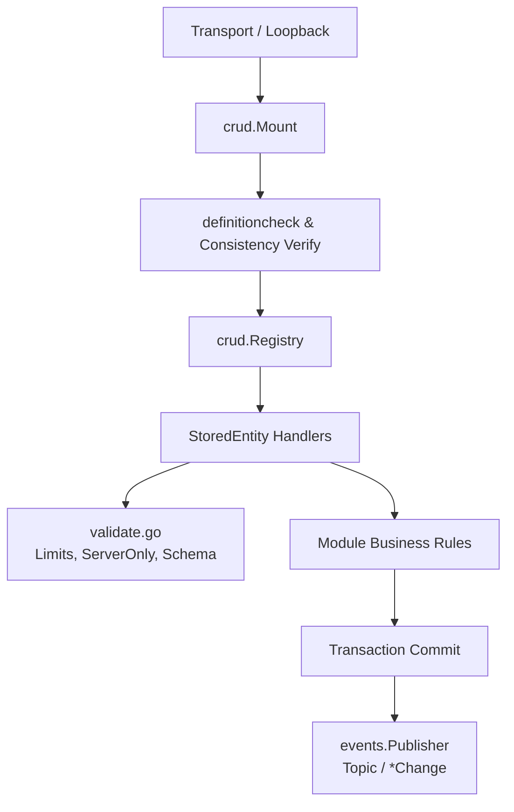

# Architecture

## 1. Overview & Context

`webtyp/crud` provides a standardized, closed execution engine for data operations across domain modules. It serves as the single transactional and validation boundary between transports (`rpc`, `mcp`, `dbsync`, or in-process `Loopback`) and persistence stores (`orm.TenantStore`, `orm.GlobalStore`).

For visual context on how `crud` interfaces with upstream contracts and downstream consumers, see [`docs/diagrams/PLACEMENT.md`](diagrams/PLACEMENT.md).

## 2. Core Abstractions

1. **[`crud.Module`](../contract.go):** The domain module contract. A module declares its entities and rules via `Definition() model.ModuleDefinition` and mounts operations through `MountOperations(crud.Registry)`.
2. **[`crud.Registry`](../contract.go):** The restricted mounting interface passed to modules. Only allows mounting entities via `AddStoredEntity` or read-only wire projections via `AddReadOnlyEntity`.
3. **[`crud.StoredEntity`](../contract.go):** Represents a persistent domain entity. Connects `Store`, declared `model.Rules`, and optional business rules for Create, Update, Delete, or Search.
4. **[`crud.CurrentUser`](../contract.go):** Explicit actor identity containing `UserID` extracted directly from verified session context—never read from request parameters.
5. **[`crud.RuleAnswer`](../result.go):** Typed business rule response (`ApplyAndPublish` or `ApplyWithoutPublishing`). The zero value is refused (`ErrNoAnswer`).

## 3. Execution & Data Flow

For details on write operation progression, see [`docs/diagrams/WRITE_FLOW.md`](diagrams/WRITE_FLOW.md).

- **Transactional Boundaries:** All batch mutations (Create, Update, Delete) execute inside atomic transactions via `inTransaction(Store, fn)`. If any record or hook fails, the entire transaction rolls back.
- **Post-Commit Publishing:** Events are published **strictly after the transaction commits**, never inside. This eliminates ghost events caused by rollbacks or connection drops during commit.
- **Event Notification:** Published via `events.Publisher` using canonical topics formatted by `crud.Topic(module, entity, action)` (e.g. `patients.patient.created`) carrying a `*crud.Change` payload with the stored record and touched update fields.
- **Queries and Limits:** Read queries enforce `Cap(limit)` bounded by `MaxPage` (500). Pagination cursors operate through stable primary key ordering.

## 4. Cross-Cutting Concerns

- **Startup Consistency Verification:** `crud.Mount` compares the module's declared `Definition()` against what was mounted in `MountOperations()`. If an entity is missing, unexpected, or declared rules mismatch attached hooks, `Mount` refuses to serve (`ErrGeneratedOutOfDate`).
- **Standardized Operation Identity:** Operations are addressed strictly by `router.Operation{Module, Entity, Action}`, eliminating string manipulation.
- **Tenant Isolation (Rule R1):** Search conditions passed to `Store` must evaluate with `Logic() == "AND"`. `OR` conditions are rejected (`ErrOrCondition`) to prevent cross-tenant record leakage in unparenthesized SQL filters.
- **Defense in Depth (`validate.go`):** Rejects oversized IDs and search terms, prevents client modification of `ServerOnly` fields on write, and validates payloads against declarative model definitions.
