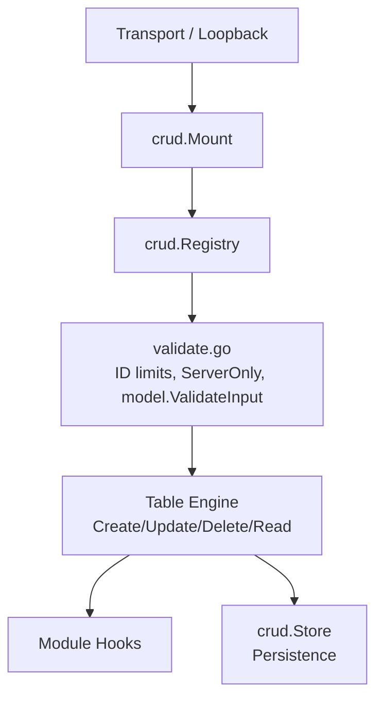

# Architecture

## Transport → crud.Mount → Registry → validate.go → Module

The CRUD architecture enforces a closed, declarative boundary between transports and domain logic:

**Rule R1**: Every condition passed to a `Store` has `Logic() == "AND"`. Conditions are not grouped (evaluated left to right); an `OR` would turn `tenant = X AND a OR b` into a cross-tenant read.

1. **Closed Contract:** A domain module only receives `crud.Registry`. It has no access to transport-specific abstractions (`router.Context`, raw routes, or query strings).
2. **Standardized Operations:** Operation names (`Op(m, action)`) are strictly derived as `<ModelName>_<action>` (e.g., `patient_c`, `patient_r`, `patient_u`, `patient_d`).
3. **Automatic RBAC:** `crud.Mount` automatically applies `Requires(Resource(ModelName), action)`. `crud.Route` only exposes `RequiresMFA()` and `Describe(text)` — there is no `Public()`, `Authenticated()` or `Requires()` exposed to modules.
4. **App-Declared Public Reads:** Only the application composition root can declare public reads via `App.PublicReads` passed into `crud.Mount`.
5. **Caller Context:** Identity is passed directly to module handlers via `crud.Caller{UserID: ...}` populated from authenticated sessions.
6. **Defense in Depth (`validate.go`):** Oversized queries and cursors are rejected with `ErrArgTooLong`, batch sizes are enforced against `MaxPage`, fields marked `ServerOnly` cannot be written by clients on Create or Update, and filters are validated against their schema with `model.ValidateInput`.
