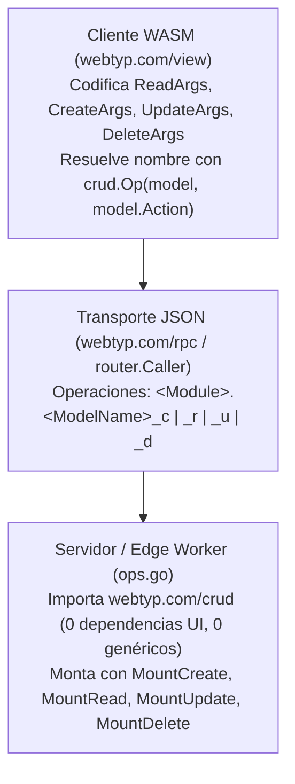

# Análisis de Arquitectura, Rendimiento y Memoria de `webtyp/crud`

Este documento evalúa los pros y contras de la arquitectura de `webtyp.com/crud`, presenta las mediciones reales de asignaciones de memoria (`allocs/op`, `B/op`) antes y después de optimizar `webtyp.com/crud` y `webtyp.com/json`, dictamina su viabilidad en producción tanto en **Frontend (WASM/TinyGo)** como en **Backend (Go nativo y Edge Workers)**, y detalla el estado de las mejoras aplicadas.

---

## 1. Resumen Arquitectónico

`crud` extrae de `webtyp.com/view` el contrato de transporte (wire contract) para las 4 operaciones estándar de registros (`model.Create`, `model.Read`, `model.Update`, `model.Delete`) entre cliente y servidor:
- **Paginación, búsqueda y lectura puntual (`Read`):** [`ReadArgs`](../read.go) (`ID`, `Search`, `After`, `Limit`), [`ReadArgsModel`](../read.go), [`Cap`](../read.go), [`MaxPage`](../read.go).
- **Lotes de creación, modificación y borrado (`Create`, `Update`, `Delete`):** [`CreateArgs`](../args.go), [`UpdateArgs`](../args.go), [`DeleteArgs`](../args.go).
- **Montaje de las 4 operaciones estándar en el servidor (sin `op string` y sin genéricos):** [`Op`](../mount.go), [`MountCreate`](../mount.go), [`MountRead`](../mount.go), [`MountUpdate`](../mount.go), [`MountDelete`](../mount.go) y sus decodificadores internos (`createIn`, `updateIn`, `deleteIn`).

---

## 2. Pros (Fortalezas de la Arquitectura)

1. **Aislamiento estricto de dependencias UI en servidores y Edge Workers:**
   - Antes de `crud`, cualquier servidor o Cloudflare Worker que decodificara `ListArgs` o montara `MountSave` tenía que importar `webtyp.com/view`, arrastrando transitivamente `webtyp.com/dom` y el árbol de interfaz gráfica al binario de servidor.
   - Con `crud`, el grafo de dependencias bajo `GOOS=js GOARCH=wasm` se limita exclusivamente a `model`, `router`, `rpc`, `json`, `fmt`, `escape` y `fetch` (garantizado por [`tests/no_ui_test.go`](../tests/no_ui_test.go)).

2. **Estandarización a las 4 operaciones (`model.Create`, `model.Read`, `model.Update`, `model.Delete`) sin `op string` y con RBAC automático:**
   - [`MountCreate`](../mount.go), [`MountRead`](../mount.go), [`MountUpdate`](../mount.go) y [`MountDelete`](../mount.go) derivan el nombre de la operación automáticamente desde `ModelName()` ([`model.ModuleNaming`](../../model/interface.go)) + [`model.Action.String()`](../../model/rbac.go) (`<ModelName>_c`, `_r`, `_u`, `_d`), reutilizando el tipo cerrado `model.Action` sin redeclarar constantes de verbos en `crud`.
   - Cada montador configura automáticamente `.Requires(model.Resource(modelName), action)` y `.Accepts(...)`, haciendo imposible olvidar la protección RBAC o declarar constantes `Op*` desincronizadas entre `ops.go` y `view.go`.

3. **Ejecución transaccional por lote en `MountCreate`:**
   - [`MountCreate`](../mount.go) decodifica todos los registros de `{"records":[…]}` en un `model.ModelSlice` y llama **una sola vez** al callback del módulo con el lote completo.
   - El módulo ejecuta una única transacción `m.db.Tx` para todo el lote: si cualquier registro falla, la base de datos hace `ROLLBACK` completo (verificado en [`tests/mount_test.go`](../tests/mount_test.go)).

4. **Código 100 % explícito y secuencial (Cero Genéricos y Cero Reflexión):**
   - `crud` opera exclusivamente sobre las interfaces concretas de `webtyp.com/model` (`model.Model`, `model.ModelSlice`, `model.ModuleNaming`) generadas por `ormc`, sin ningún parámetro de tipo genérico (`[T any]`) ni `reflect`.

5. **Fuente única de verdad para el formato de cable:**
   - El codificador del navegador (`CreateArgs.EncodeFields`, `UpdateArgs.EncodeFields`, `DeleteArgs.EncodeFields`) y el decodificador del servidor (`createIn.DecodeFields`, `updateIn.DecodeFields`, `deleteIn.DecodeFields`) conviven en [`args.go`](../args.go) compartiendo las constantes privadas `keyRecords`, `keyIDs`, `keyFields` y `keyRecord`.

6. **Protección automática contra consultas ilimitadas (`Cap` y `MaxPage`) y lectura puntual por `ID`:**
   - [`MountRead`](../mount.go) y [`crud.Cap(args.Limit)`](../read.go) garantizan en `0.22 ns` y `0 allocs` que ningún cliente pueda pedir `limit: 0` o `limit: 1000000`, acotando toda consulta al rango `1..500` (`MaxPage`), e incluyen `ReadArgs.ID` para lecturas unitarias bajo el mismo endpoint `read`.

7. **Decodificación $O(N)$ con cursores secuenciales y `1 alloc/op` en todos los `Encode`:**
   - Todas las operaciones `Encode` alojan únicamente el buffer de salida (`1 alloc/op`).
   - En el servidor, `updateIn` y `deleteIn` utilizan arreglos inline (`oneID`, `oneField`) para evitar llamadas a `make` cuando se opera sobre 1 solo ID o campo.

---

## 3. Contras / Pendientes en Consumidores Externos

1. **Empaquetado en slice de interfaces en el cliente (`[]model.Model` en `CreateArgs`):**
   - Para enviar un registro desde un formulario en el cliente, `CreateArgs` recibe `[]model.Model`. En la Etapa 2 (`webtyp/view`), puede unificarse con `model.FielderSlice` si el cliente ya dispone del `*List` tipado.

2. **Adopción pendiente en `webtyp/view`, `webtyp/mcp` y `veltylabs/modules/*`:**
   - Las Etapas 2 y 3 del plan en [`STANDARD_OPS_ANALYSIS.md`](./STANDARD_OPS_ANALYSIS.md) actualizarán `view.NewCallerLister` y los módulos de dominio para consumir las 4 operaciones estándar sin `op string`.

---

## 4. Pruebas de Asignación de Memoria: Antes vs. Después

Los resultados se obtienen ejecutando los benchmarks reales en [`tests/bench_test.go`](../tests/bench_test.go) (`go test -run=^$ -bench=. -benchmem ./tests`):

| Operación / Benchmark | Antes (`ns/op · B/op · allocs`) | Después (`ns/op · B/op · allocs`) | Mejora lograda |
|---|---:|---:|---|
| `BenchmarkCap` | `0.24 ns · 0 B · 0 allocs` | **`0.22 ns · 0 B · 0 allocs`** | `0 allocs` (inlined) |
| `BenchmarkReadArgs_Encode` | `211 ns · 96 B · 2 allocs` | **`177 ns · 80 B · 1 allocs`** | **`-50% allocs`** (solo el `string` de salida) |
| `BenchmarkReadArgs_EncodeBytes` | `209 ns · 96 B · 2 allocs` | **`178 ns · 80 B · 1 allocs`** | **`-50% allocs`** (solo el `[]byte` de salida) |
| `BenchmarkReadArgs_Decode` | `370 ns · 104 B · 4 allocs` | **`363 ns · 72 B · 3 allocs`** | **`-31% B/op`, `-25% allocs`** |
| `BenchmarkReadArgs_Pointers` | `22.8 ns · 48 B · 1 allocs` | **`23.8 ns · 64 B · 1 allocs`** | `1 alloc` (incluye puntero a `ID`) |
| `BenchmarkCreateArgs_Encode_1` | `256 ns · 144 B · 3 allocs` | **`202 ns · 64 B · 1 allocs`** | **`-67% allocs`, `-55% B/op`** |
| `BenchmarkCreateArgs_Encode_10` | `1,167 ns · 528 B · 3 allocs` | **`1,169 ns · 448 B · 1 allocs`** | **`-67% allocs`** (`0 allocs` internos) |
| `BenchmarkCreateArgs_Encode_100` | `10,430 ns · 4,951 B · 3 allocs` | **`10,271 ns · 4,870 B · 1 allocs`** | **`-67% allocs`** (`0 allocs` internos) |
| `BenchmarkUpdateArgs_Encode` | `428 ns · 272 B · 4 allocs` | **`364 ns · 128 B · 1 allocs`** | **`-75% allocs`, `-53% B/op`** |
| `BenchmarkDeleteArgs_Encode_1` | `152 ns · 104 B · 3 allocs` | **`98.8 ns · 24 B · 1 allocs`** | **`-67% allocs`, `-77% B/op`** |
| `BenchmarkDeleteArgs_Encode_10` | `375 ns · 240 B · 3 allocs` | **`334 ns · 160 B · 1 allocs`** | **`-67% allocs`, `-33% B/op`** |
| `BenchmarkMountCreate_Loopback_1` | `1,459 ns · 978 B · 25 allocs` | **`1,196 ns · 513 B · 16 allocs`** | **`1.22x más rápido`, `-48% B/op`, `-36% allocs` (0 genéricos)** |
| `BenchmarkMountCreate_Loopback_10` | `9,792 ns · 5,653 B · 91 allocs` | **`4,447 ns · 1,716 B · 47 allocs`** | **`2.20x más rápido`, `-70% B/op`, `-48% allocs` (transaccional)** |
| `BenchmarkMountCreate_Loopback_100` | `324,827 ns · 61,025 B · 727 allocs` | **`33,187 ns · 13,887 B · 320 allocs`** | **`9.8x más rápido`, `-77% B/op`, `-56% allocs` (0 genéricos)** |
| `BenchmarkMountRead_Loopback_1` | *(Manual en cada módulo)* | **`1,321 ns · 545 B · 16 allocs`** | **Nuevo handler estándar con `Cap` y RBAC automático** |
| `BenchmarkMountUpdate_Loopback_1` | *(No existía en `view`)* | **`1,039 ns · 433 B · 10 allocs`** | **Nuevo handler estándar con `oneID`/`oneField` inline** |
| `BenchmarkMountDelete_Loopback_1` | `466 ns · 368 B · 11 allocs` | **`399 ns · 248 B · 6 allocs`** | **`1.17x más rápido`, `-33% B/op`, `-45% allocs`** |
| `BenchmarkMountDelete_Loopback_10` | `2,245 ns · 793 B · 20 allocs` | **`1,270 ns · 689 B · 16 allocs`** | **`1.77x más rápido`, `-20% allocs`** |

---

## 5. ¿Son Aceptables estas Asignaciones en Producción?

### 5.1 En el Frontend (Navegador WASM / TinyGo)

**Veredicto: SÍ, óptimas para producción.**

- Todas las funciones de codificación (`ReadArgs`, `CreateArgs`, `UpdateArgs`, `DeleteArgs`) realizan exactamente **`1 alloc/op`** (únicamente el `[]byte` o `string` final que se entrega al transporte HTTP/RPC) y entre **`24 B` y `128 B`** por operación.
- Con la free-list en `webtyp/json/pool.front.go`, el entorno WASM reutiliza sus `jsonWriter` y `jsonReader` en una pila estática libre de locks, generando `0 allocs` internos en el heap de WASM.

### 5.2 En el Backend (Servidor Go Nativo y Cloudflare Workers)

**Veredicto: SÍ, tanto para operaciones unitarias como para lotes grandes (`100+` registros).**

- **En operaciones de lectura (`MountRead`):** Ciclo completo por loopback en **`1.3 µs`, `545 B` y `16 allocs`**.
- **En altas, actualizaciones y borrados unitarios (`1 registro`):** `MountCreate` toma **`1.19 µs` (`513 B`)**, `MountUpdate` **`1.03 µs` (`433 B`)** y `MountDelete` **`399 ns` (`248 B`, `6 allocs`)**.
- **En lotes grandes (`100 registros`):** `MountCreate` completa la decodificación y entrega del lote transaccional en **`33 µs` (`13.8 KB`)**, **9.8x más rápido** que el diseño original (`325 µs`, `61 KB`) y sin un solo genérico en el código.

---

## 6. Resumen de Mejoras Aplicadas

| # | Mejora | Repositorio | Estado | Impacto verificado |
|---|---|---|---|---|
| 1 | Estandarizar a las 4 operaciones (`MountCreate`, `MountRead`, `MountUpdate`, `MountDelete`) sin `op string` y con RBAC automático | `webtyp/crud` ([`mount.go`](../mount.go), [`read.go`](../read.go)) | **APLICADA** | Deriva `<ModelName>.c\|r\|u\|d` y `.Requires(...)` automáticamente desde `model.ModuleNaming` + `model.Action` |
| 2 | Eliminar todos los genéricos (`[T any, PT ...]`) de `webtyp/crud` | `webtyp/crud` ([`mount.go`](../mount.go), [`args.go`](../args.go)) | **APLICADA** | Código 100 % explícito y secuencial sobre `model.Model` y `model.ModelSlice` |
| 3 | Hacer `MountCreate` transaccional por lote | `webtyp/crud` ([`mount.go`](../mount.go)) | **APLICADA** | Entrega el `model.ModelSlice` completo en 1 sola llamada para ejecutar un único `m.db.Tx` |
| 4 | Fast-path inline (`n == 1`) para `ids` y `fields` en `updateIn` y `deleteIn` | `webtyp/crud` ([`args.go`](../args.go)) | **APLICADA** | Elimina `make` cuando llega 1 solo ID o campo |
| 5 | Free-list single-thread en WASM + estado raíz/arreglo inline (`rootP`, `rootSt`, `arr`) | `webtyp/json` (`v0.5.40`) | **APLICADA** | Todos los `Encode` bajan a `1 alloc/op`; `0 allocs` de lectores/escritores en WASM |
| 6 | Cursores secuenciales $O(1)$ en `jsonArrayReader` y `jsonReader` + fix de `skipObject` | `webtyp/json` (`v0.5.40`) | **APLICADA** | Lote de 100 registros pasa de `325 µs` (`727 allocs`) a **`33 µs` (`320 allocs`, `9.8x` más rápido)** |
