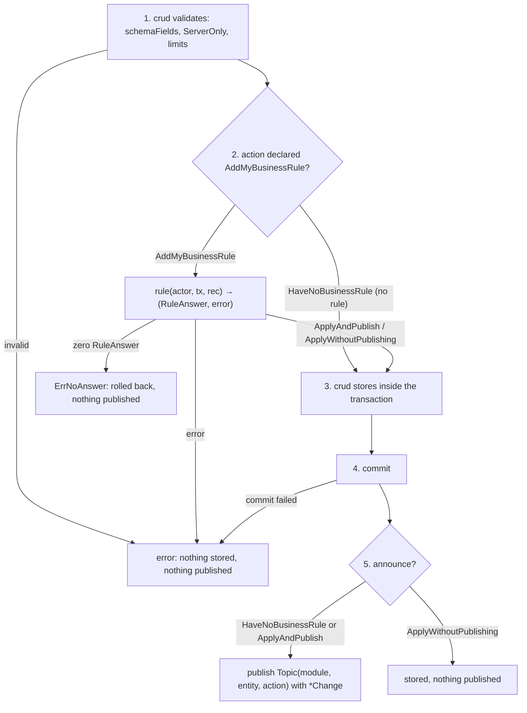

← [Stage 0](PLAN_STAGE_0_NAMES.md) | Next → [Stage 2](PLAN_STAGE_2_TYPES.md)

# Stage 1 — tests first (red)

Diagram first: write `docs/diagrams/WRITE_FLOW.md` now (the walkthrough of stage 5 is filled in then) with this `flowchart TD`, and make the tests walk **every branch** of it:



## 1.1 Mechanical edits to every existing file in `tests/`

| Old | New |
|---|---|
| `crud.Caller` | `crud.CurrentUser` (files: `stored_entity_test.go`, `filter_test.go`) |
| `crud.Mount(x, nil, m)` | `crud.Mount(x, nil, nil, m)` (4 calls) |
| `crud.Loopback(m...)` | `crud.Loopback(nil, m...)` |
| `crud.LoopbackActingAs("u1", m...)` | `crud.LoopbackActingAs(nil, "u1", m...)` |
| hook `func(c crud.Caller, tx crud.Tx, rec model.Model) error` | `func(c crud.CurrentUser, tx crud.Tx, rec model.Model) (crud.RuleAnswer, error)`; the body that returned `nil` returns `crud.ApplyAndPublish, nil`; the body that returned an error returns `0, err` |
| same for `Update` and `Delete` hooks | same shape; `Search` and `NewFilter` do not change |
| `Committed: …` | deleted (see 1.3) |

## 1.2 Test module and rules helper

In `tests/stored_entity_test.go` the module fixture becomes (it now must implement `Definition`):

```go
type testModule struct {
	table crud.StoredEntity
}

func (m *testModule) ModelName() string { return "tmod" }
func (m *testModule) MountOperations(reg crud.Registry) { reg.AddStoredEntity(m.table) }
func (m *testModule) Definition() model.ModuleDefinition {
	return model.ModuleDefinition{Name: "tmod", Entities: []model.Definition{{
		Name:  m.table.Model.ModelName(),
		Allow: m.table.Model.(model.Allower).Allow(),
		Rules: m.table.Rules,
	}}}
}
```

`filterTestModule` (`tests/filter_test.go`) adds, with the wire model it mounts through `reg.Read`:

```go
func (m *filterTestModule) Definition() model.ModuleDefinition {
	return model.ModuleDefinition{Name: "filtertest", Entities: []model.Definition{{
		Name: "mock", Wire: true, Allow: model.Read, Rules: model.Rules{Read: model.AddMyBusinessRule}}}}
}
```
(`mock` is `mockRecord.ModelName()` in `tests/mock_record.go`; if `filter_test.go` mounts a different record, use that record's `ModelName()`.)

New file `tests/helpers_test.go`:

```go
package tests

import (
	"webtyp.com/events"
	"webtyp.com/model"
)

// declareRules declares every action in allow: AddMyBusinessRule when it is in domain, HaveNoBusinessRule otherwise.
func declareRules(allow, domain model.Action) model.Rules {
	var r model.Rules
	set := func(a model.Action, dst *model.RuleMode) {
		if !allow.Has(a) {
			return
		}
		if domain.Has(a) {
			*dst = model.AddMyBusinessRule
		} else {
			*dst = model.HaveNoBusinessRule
		}
	}
	set(model.Create, &r.Create)
	set(model.Read, &r.Read)
	set(model.Update, &r.Update)
	set(model.Delete, &r.Delete)
	return r
}

// eventRecorder is an events.Publisher that remembers what was published, in order.
type eventRecorder struct{ got []events.Event }

func (r *recorder) Publish(e events.Event) { r.got = append(r.got, e) }
```

Every `crud.StoredEntity{…}` literal in `tests/` gets a `Rules:` field. `a.Allow()` is the model's `Allow()`:

| Test | `Rules:` |
|---|---|
| `TestStoredEntity_NothingAllowedFailsMount` | none (the mount fails first) |
| `TestStoredEntity_NotAllowedActionDoesNotExist` | `declareRules(model.Create\|model.Read, 0)` |
| `TestStoredEntity_HookWithoutActionFailsMount` | `declareRules(model.Create\|model.Read, 0)` |
| `TestStoredEntity_CreateBatchIsAtomic`, `TestStoredEntity_PublicCreateWithoutSession` | `declareRules(model.AllActions, model.Create)` |
| `TestStoredEntity_UpdateHookSeesOldAndNext` | `declareRules(model.AllActions, model.Update)` |
| `TestStoredEntity_SearchHookOrIsRejected` | `declareRules(model.AllActions, model.Read)` |
| every other `crud.StoredEntity` literal (no hook) | `declareRules(model.AllActions, 0)` — for a model whose `Allow()` is not `AllActions` use that model's `Allow()` |

## 1.3 Tests removed and added

Delete `TestStoredEntity_CommittedAfterCommitOnly` and `TestStoredEntity_CommittedUpdateCarriesEachID` (their rows leave `docs/TESTS.md`). Add, in `tests/write_flow_test.go`
(package `tests`; `store := newMemStore()`, `rec := &eventRecorder{}`, call through `crud.LoopbackActingAs(rec, "u1", mod)` and the existing
`caller.Call("tmod."+crud.Op(&tRec{}, model.Create), args, &out, func(e error){ err = e })` pattern):

| Test | setup → call → expected |
|---|---|
| `TestWrite_AnnounceIsPublishedAfterCommit` | `Rules: declareRules(All, model.Create)`, `Create` hook returns `crud.ApplyAndPublish, nil`; create one record → `len(rec.got)==1`, `rec.got[0].Topic=="tmod.t.created"`, payload is `*crud.Change` whose `Record.(*tRec).ID` equals the saved id, `Fields==nil` |
| `TestWrite_SilentStoresWithoutPublishing` | hook returns `crud.ApplyWithoutPublishing, nil` → row stored (`store` has 1 row), `len(rec.got)==0` |
| `TestWrite_StandardAlwaysAnnounces` | `declareRules(All, 0)`, no hook; create → `len(rec.got)==1`, topic `tmod.t.created` |
| `TestWrite_RuleErrorPublishesNothing` | hook returns `crud.RuleAnswer{}, model.Conflict("no")` → `err` contains `no`, `len(rec.got)==0`, store empty |
| `TestWrite_ZeroResultIsRefused` | hook returns `crud.RuleAnswer{}, nil` → `err != nil`, `err` does **not** contain `answered nothing` (an internal error shows the client only the generic text, `router.WriteError`), `len(rec.got)==0`, store empty (rolled back) |
| `TestWrite_BatchRollbackPublishesNothing` | hook fails on the 2nd of 2 records → store empty, `len(rec.got)==0` |
| `TestWrite_UpdateEventCarriesFieldsAndEachID` | store has rows `a`,`b`; `Rules: declareRules(All,0)`; update ids `["a","b"]`, fields `["name"]` → 2 events, topics `tmod.t.updated`, `Record.(*tRec).ID` is `"a"` then `"b"` (read after both were published: the records are distinct copies), each `Fields == ["name"]` |
| `TestWrite_UpdateSilentForOneID` | `Rules: declareRules(All, model.Update)`; hook returns `ApplyWithoutPublishing` when `next.(*tRec).ID=="a"` and `ApplyAndPublish` otherwise → events only for `b` |
| `TestWrite_DeleteEventCarriesStoredRow` | store has row `a` named `x`; delete `["a"]` → 1 event `tmod.t.deleted`, `Record.(*tRec).Name=="x"`, `Fields==nil` |
| `TestWrite_NoPublisherIsFine` | `crud.LoopbackActingAs(nil, "u1", mod)`; create → no error, row stored |
| `TestWrite_ReadNeverPublishes` | read all → `len(rec.got)==0` |
| `TestTopic_Shape` | `crud.Topic("agenda","patient",model.Create)=="agenda.patient.created"`, `Update`→`…updated`, `Delete`→`…deleted`, `Read`→`""` |
| `TestChange_EncodesRecordAndFields` | encode `&crud.Change{Record:&tRec{ID:"a"}, Fields:[]string{"name"}}` with the recording writer below → calls `Object("record")` then `Array("fields",1)` with `String("name")`; a `Change{Record:r}` with no fields emits no `fields` array |

Recording writer for the last test (in `tests/write_flow_test.go`; it implements `model.FieldWriter` and `model.ArrayWriter` completely, from `model/codec.go:6` and `:21`):

```go
type recordingFieldWriter struct {
	objects []string // names passed to Object
	arrays  []string // names passed to Array
	strs    []string // strings pushed into any array
}

func (w *recordingFieldWriter) String(name, val string)                 {}
func (w *recordingFieldWriter) Int(name string, val int64)              {}
func (w *recordingFieldWriter) Float(name string, val float64)          {}
func (w *recordingFieldWriter) Bool(name string, val bool)              {}
func (w *recordingFieldWriter) Bytes(name string, val []byte)           {}
func (w *recordingFieldWriter) Null(name string)                        {}
func (w *recordingFieldWriter) Raw(name, val string)                    {}
func (w *recordingFieldWriter) Object(name string, val model.Encodable) { w.objects = append(w.objects, name) }
func (w *recordingFieldWriter) Array(name string, n int) model.ArrayWriter {
	w.arrays = append(w.arrays, name)
	return &recordingArray{parent: w}
}

type recordingArray struct{ parent *recordingFieldWriter }

func (a *recordingArray) String(val string)            { a.parent.strs = append(a.parent.strs, val) }
func (a *recordingArray) Int(val int64)                {}
func (a *recordingArray) Float(val float64)            {}
func (a *recordingArray) Bool(val bool)                {}
func (a *recordingArray) Bytes(val []byte)             {}
func (a *recordingArray) Object(val model.Encodable)   {}
func (a *recordingArray) Close()                       {}
```

| Test (file `tests/mount_check_test.go`) | setup → call → expected |
|---|---|
| `TestMount_DomainWithoutHookIsOutOfDate` | `Rules: declareRules(All, model.Create)`, `Create` hook nil → `crud.Mount(reg,nil,nil,mod)` returns an error whose text contains `definitionc` and `t` |
| `TestMount_HookWithoutDomainIsOutOfDate` | `Rules: declareRules(All, 0)`, `Create` hook set → error contains `definitionc` |
| `TestMount_SearchHookFollowsReadRule` | `Rules.Read` HaveNoBusinessRule + `Search` set → error contains `definitionc`; `Rules.Read` AddMyBusinessRule + `Search` nil → error contains `definitionc` |
| `TestMount_AllowedActionWithoutRuleIsRefused` | `Rules: model.Rules{}` with `Allow()==All` → error contains `must declare its rule` |
| `TestMount_HandlerListedButNotMounted` | module whose `Definition()` lists handlers `t` and `u` (Allow Create) but whose `MountOperations` mounts only `t` → error contains `definitionc` and `u` |
| `TestMount_MountedButNotListed` | `Definition()` lists no handler, `MountOperations` mounts `t` → error contains `definitionc` and `t` |
| `TestMount_DefinitionNameMustMatchModelName` | `Definition().Name == "other"`, `ModelName() == "tmod"` → error contains `definitionc` |
| `TestMount_InternalHandlerIsNotMounted` | `Definition()` lists a handler with `Allow == 0` and nothing mounts it → `Mount` returns nil |
| `TestMount_ConsistentModuleMounts` | `Rules: declareRules(All, model.Create)`, hook set → `Mount` returns nil and `reg.Has("t_c")` |

Run `gotest`: the suite does not compile (new symbols). Commit: `test: results, events, actor, definition check (red)`.
