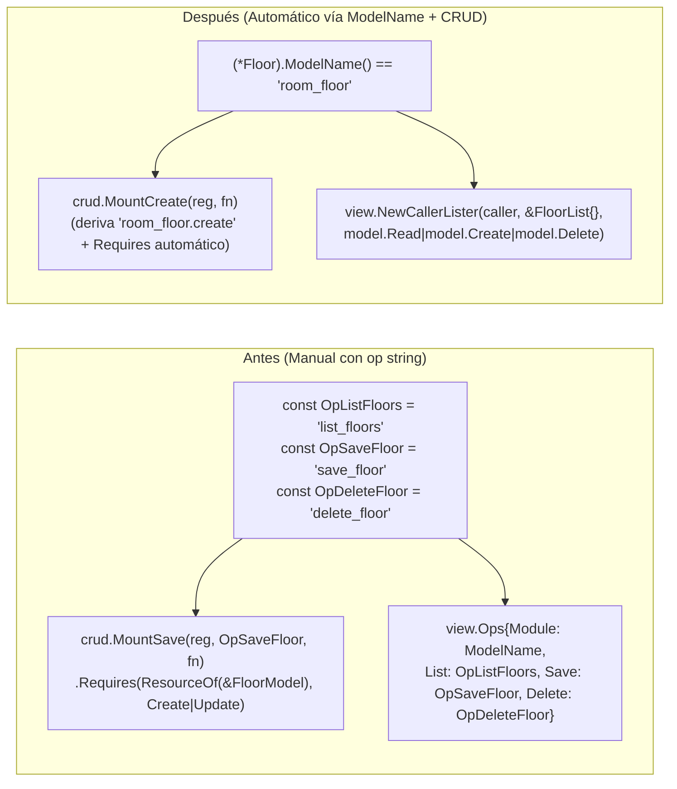

# Análisis de Pros y Contras: Estandarización a las 4 Operaciones (`create`, `read`, `update`, `delete`) sin `op string`

Este documento analiza la propuesta de eliminar el parámetro `op string` de `webtyp.com/crud` (y las constantes `Op*` manuales en los módulos) apalancando el contrato existente [`model.ModuleNaming`](../../model/interface.go) (`ModelName() string`) y el conjunto cerrado de 4 operaciones de persistencia (`create`, `read`, `update`, `delete`).

---

## 1. Diagnóstico del Estado Actual

Actualmente, el ecosistema ya cuenta con dos piezas fundamentales en `webtyp.com/model`:

1. **Identidad tipada por modelo ([`model.ModuleNaming`](../../model/interface.go)):**
   Cada entidad generada por `ormc` implementa `model.Model`, que embebe `ModuleNaming`:
   ```go
   type ModuleNaming interface {
       ModelName() string
   }
   ```
   Por ejemplo, en `room_layout`:
   - `(*Floor).ModelName()` → `"room_floor"`
   - `(*Room).ModelName()` → `"room_space"`
   - `(*RoomArtifact).ModelName()` → `"room_artifact"`
   - `(*Equipment).ModelName()` → `"room_equipment"`

2. **Vocabulario cerrado de 4 acciones ([`model.Action`](../../model/rbac.go)):**
   ```go
   const (
       Create Action = 1 << iota // "c"
       Read                      // "r"
       Update                    // "u"
       Delete                    // "d"
   )
   ```

### El problema actual: Redundancia e inconsistencia manual

A pesar de tener ambos contratos, hoy cada módulo declara manualmente constantes `Op*` con nombres arbitrarios y las pasa por parámetro tanto en el servidor (`ops.go`) como en el cliente (`view.go`):

- En `room_layout/ops.go`: `OpListFloors = "list_floors"`, `OpSaveFloor = "save_floor"`, `OpDeleteFloor = "delete_floor"`.
- En `pharmacy_manager/ops.go`: `OpListProducts = "list_products"`, `OpUpsertProduct = "upsert_product"`, `OpUpdateProduct = "update_product"`, `OpDeleteProduct = "delete_product"`.
- En `business_calendar/ops.go`: `OpListHolidays = "list_holidays"`, `OpAddHoliday = "add_holiday"`, `OpRemoveHoliday = "remove_holiday"`.

Esto obliga a pasar `op string` en [`crud.MountSave`](../mount.go), [`crud.MountUpdate`](../mount.go) y [`crud.MountDelete`](../mount.go), y a repetir esos mismos strings en `view.Ops{Module: ModelName, List: ..., Save: ..., Update: ..., Delete: ...}`.

---

## 2. Cómo Funcionaría el Diseño Estandarizado

### Requisito técnico clave: Módulos con múltiples entidades (`PT.ModelName()`)

Un módulo de dominio suele gestionar **más de una tabla CRUD** (por ejemplo, `room_layout` gestiona `Floor`, `Room`, `RoomArtifact` y `Equipment`; `pharmacy_manager` gestiona `PharmacyProduct` y `PharmacyLocation`; `alert_manager` gestiona `AlertChannel`, `AlertChannelSetting`, `AlertRule` y `AlertAssignment`).

- Si el nombre en el registro fuera únicamente `"create"`, `"read"`, `"update"`, `"delete"` a nivel de módulo (`room_layout.create`), **habría colisión inmediata** al montar la segunda tabla del mismo módulo (`Floor` y `Room` registrarían ambos `room_layout.create`).
- **La solución está en [`model.ModuleNaming`](../../model/interface.go):** como cada función `crud.Mount*` está parametrizada con el modelo `PT` (`interface { *T; model.Model }`), `crud` puede obtener `PT(new(T)).ModelName()` (ej. `"room_floor"`, `"room_space"`) y componer internamente el nombre canónico con la acción (`"room_floor.create"`, `"room_floor.read"`, `"room_floor.update"`, `"room_floor.delete"`), **sin recibir jamás `op string` por parámetro**.



### Comparativa de código en un módulo real (`room_layout`)

**Antes (`ops.go` + `view.go`):**
```go
const (
    OpListFloors   = "list_floors"
    OpSaveFloor    = "save_floor"
    OpUpdateFloor  = "update_floor"
    OpDeleteFloor  = "delete_floor"
)

// En MountOperations(reg):
reg.Operation(OpListFloors, m.opListFloors).
    Requires(model.ResourceOf(&FloorModel), model.Read).
    Accepts(&crud.ListArgs{})
crud.MountSave(reg, OpSaveFloor, m.saveFloor).
    Requires(model.ResourceOf(&FloorModel), model.Create|model.Update)
crud.MountUpdate(reg, OpUpdateFloor, m.PatchFloors).
    Requires(model.ResourceOf(&FloorModel), model.Update)
crud.MountDelete(reg, OpDeleteFloor, m. deleteFloors).
    Requires(model.ResourceOf(&FloorModel), model.Delete)

// En view.go:
view.Ops{
    Module: ModelName,
    List:   OpListFloors,
    Save:   OpSaveFloor,
    Update: OpUpdateFloor,
    Delete: OpDeleteFloor,
}
```

**Después (`ops.go` + `view.go` — 0 constantes `Op*`, 0 `op string`, 0 `.Requires` manuales):**
```go
// En MountOperations(reg):
crud.MountRead(reg, m.listFloors)     // registra "room_floor.read",   Requires("room_floor", model.Read)
crud.MountCreate(reg, m.saveFloor)    // registra "room_floor.create", Requires("room_floor", model.Create|model.Update)
crud.MountUpdate(reg, m.PatchFloors)  // registra "room_floor.update", Requires("room_floor", model.Update)
crud.MountDelete[Floor](reg, m.deleteFloors) // registra "room_floor.delete", Requires("room_floor", model.Delete)
```

---

## 3. Pros (Ventajas del Cambio)

1. **Eliminación definitiva de `op string` y de decenas de constantes `Op*` por módulo:**
   - Se borran todas las constantes `OpList*`, `OpSave*`, `OpUpsert*`, `OpAdd*`, `OpUpdate*`, `OpDelete*`, `OpRemove*` de `ops.go` en todos los módulos.
   - Si el módulo monta las 4 operaciones para una entidad, quedan las 4; si solo monta `Read` y `Create` (por ejemplo, en `business_calendar` para `BusinessHours`), solo monta esas 2 y el resto no existe.

2. **Erradicación de la inconsistencia de vocabulario entre módulos:**
   - Hoy un mismo concepto se llama `"save_floor"` en `room_layout`, `"upsert_product"` en `pharmacy_manager` y `"add_holiday"` en `business_calendar`. Con el estándar, todas las entidades del ecosistema hablan exactamente los mismos 4 verbos: `create`, `read`, `update`, `delete`.

3. **Cero desincronización entre Servidor (`crud`) y Cliente (`view`):**
   - Tanto `crud` en el servidor como `view.NewCallerLister` en el navegador tienen acceso al `model.Model` (y por tanto a `ModelName()`). Ambos lados calculan el nombre de cable con la misma función pura sin que el desarrollador tenga que pasar strings en `view.Ops`.

4. **Permisos RBAC (`.Requires`) y esquemas (`.Accepts`) automáticos y a prueba de olvidos:**
   - En `webtyp/model/rbac.go`, `model.ResourceOf(&FloorModel)` devuelve `model.Resource("room_floor")`, que es idéntico a `(*Floor).ModelName()`.
   - Como `MountRead`, `MountCreate`, `MountUpdate` y `MountDelete[T]` conocen `PT(new(T)).ModelName()` y saben qué verbo están montando (`Read`, `Create`, `Update`, `Delete`), **pueden configurar `.Requires(...)` y `.Accepts(...)` automáticamente por defecto**.
   - Se elimina toda una clase de bugs donde un handler olvida declarar `.Requires(...)` o asigna por error el `ResourceOf` de otra tabla.

5. **Eliminación del boilerplate de `opList*` con `crud.MountRead`:**
   - Hoy cada entidad repite en `ops.go` entre 15 y 20 líneas idénticas para decodificar `crud.ListArgs`, aplicar `crud.Cap(args.Limit)`, convertir `[]T` a `TList` y llamar a `ctx.Encode(&list)`. Incorporar `MountRead` completa las 4 operaciones (`Read`, `Create`, `Update`, `Delete`) y reduce `ops.go` a una línea por operación.

6. **Menor tamaño de binario WASM:**
   - Al no compilar decenas de literales de string distintos (`"list_room_artifacts"`, `"upsert_assignment"`, `"delete_equipment"`, etc.) ni structs `view.Ops` con 4 strings por pantalla, se reduce el segmento de datos estáticos (rodata) en el binario WASM del navegador.

---

## 4. Contras (Desventajas, Limitaciones y Costos)

1. **No todas las operaciones de un módulo son CRUD de entidad (Operaciones de Dominio / RPC):**
   - Los módulos de negocio tienen operaciones que ejecutan comandos específicos de dominio y no encajan en el CRUD estándar de una tabla. Ejemplos reales en `veltylabs/modules`:
     - `room_layout`: `cancel_shift_occurrence`, `move_shift_occurrence`, `find_free_rooms`, `list_public_availability`, `set_room_equipment`.
     - `pharmacy_manager`: `receive_stock`, `register_entry`, `register_output`, `transfer_stock`, `list_expiring`, `list_low_stock`.
     - `network_manager`: `plan_network`, `apply_network`, `discover_network`, `import_network`.
   - **Consecuencia:** `router.OperationRegistry.Operation(name string, h HandlerFunc)` y `view.Action` deben seguir existiendo para estas acciones especiales de dominio. La estandarización aplica al 100 % del CRUD de entidades, pero convivirá con operaciones de negocio nombradas.

2. **Tensión semántica entre `Create` (estándar CRUD) y `Save/Upsert` (comportamiento actual de formularios en `view`):**
   - Actualmente en `view`, cuando el usuario guarda el formulario principal de un registro (sea nuevo o editado completo), `view` llama a `Save` (`MountSave`), mientras que `Update` (`MountUpdate`) se usa para actualizaciones parciales de campos específicos (`ids`, `fields`, `record`).
   - Si renombramos `MountSave` → `MountCreate` (operación `create`):
     - **Opción A:** `create` mantiene el comportamiento de `Save` (crea o guarda el registro completo de formulario, requiriendo `model.Create` o `model.Create|model.Update`) y `update` hace el patch parcial (`ids, fields, rec`). Es el cambio más directo, aunque el nombre `create` ejecutando un upsert de edición puede resultar menos obvio.
     - **Opción B:** `create` solo inserta registros nuevos y `update` asume tanto la edición completa como el patch parcial. Esto es semánticamente más puro respecto a RBAC (`Create` = solo crear, `Update` = solo modificar), pero exige ajustar `view` para que un formulario en modo edición invoque `update` en vez de `create`.

3. **Múltiples lecturas sobre la misma entidad (`List` vs. `Get` puntual o vistas filtradas):**
   - Algunos módulos tienen más de una lectura sobre la misma tabla (ej. en `room_layout`: `list_rooms`, `get_room`, `list_board`; en `patient_directory`: `list_patients`, `get_patient`, `find_patient_by_rut`).
   - Con un único `read` estándar por modelo (`room_space.read`), el listado paginado principal usa `MountRead`, mientras que consultas especializadas (`find_free_rooms`, `list_board`) deben declararse como modelos de consulta/proyección propios (con su propio `ModelName()`, ej. `BoardRoom` → `"board_room"`) o como operaciones de dominio.

4. **Impacto en nombres de herramientas MCP (`mcp.HarvestOps`):**
   - `mcp.HarvestOps` expone cada operación registrada como una herramienta para agentes usando `<Module.ModelName()>.<op>`.
   - Al pasar de `"pharmacy_manager.list_products"` a `"pharmacy_manager.pharmacy_product.read"` (o si el modelo tiene el mismo nombre que el módulo, ej. `"patient_directory.patient.read"`):
     - **Ventaja:** Los nombres de herramientas MCP se vuelven 100 % predecibles y uniformes en todos los módulos.
     - **Contra:** Cualquier lista explícita `expose []mcp.ToolName` en aplicaciones o tests de `mcp` deberá actualizarse al nuevo formato canónico.

5. **Costo de migración multi-repositorio:**
   - Cambiar las firmas de `crud.Mount*` (quitando `op string` y añadiendo el parámetro de tipo `[T, PT]` a `MountDelete` y el nuevo `MountRead`) y actualizar `view.Ops` / `view.NewCallerLister` es un cambio *breaking* que requiere actualizar en cascada:
     1. `webtyp/crud`
     2. `webtyp/view`
     3. Los módulos en `veltylabs/modules/*` y las apps consumidoras.

---

## 5. Soluciones Punto por Punto a cada Contra

Cada uno de los 5 contras anteriores tiene una solución arquitectónica concreta dentro de las reglas actuales del ecosistema (`webtyp/model`, `webtyp/crud`, `webtyp/view`, `webtyp/mcp`):

### Solución al Contra 1 (Operaciones de Dominio / RPC no-CRUD)
**Las "operaciones de dominio" son en realidad `update`, `create` o `read` sobre los modelos existentes:**
- Al inspeccionar qué hacen por dentro las operaciones especiales de los módulos (`shift.go`, `room.go`, `pharmacy_manager`), se observa que se crearon como endpoints sueltos únicamente porque antes no se usaba `MountUpdate` (`ids, fields, rec T`):
  - **`cancel_shift_occurrence` → es un `update` sobre `RoomShift`** (tal como ya lo delataba su propio permiso `.Requires(ResourceOf(&RoomShiftModel), model.Update)`): basta con enviar `ids: [shiftID]`, `fields: ["is_active", "specific_date"]`, `rec: RoomShift{IsActive: false, SpecificDate: date}` (o bien un `create` sobre la tabla `RoomShiftCancellation` que ya existe en `model.go`).
  - **`move_shift_occurrence` → es un `update` sobre `RoomShift`:** envía `ids: [shiftID]`, `fields: ["room_id", "specific_date"]`, `rec: RoomShift{RoomId: targetRoomID, SpecificDate: date}`.
  - **`deactivate_room`, `deactivate_product`, `deactivate_patient` → son un `update` sobre `Room`, `PharmacyProduct`, `Patient`:** envían `ids: [id]`, `fields: ["is_active"]`, `rec: {IsActive: false}`.
  - **`mark_alert_seen` → es un `update` sobre `AlertRecord`:** envía `ids: [id]`, `fields: ["seen_at"]`.
  - **`receive_stock`, `register_entry`, `register_output`, `transfer_stock` → son un `create` sobre `PharmacyMovement`**, donde el campo `movement_type` ya distingue el tipo de movimiento.
  - **`list_board`, `find_free_rooms`, `list_expiring`, `list_low_stock` → son un `read`** sobre su modelo de proyección (`BoardRoom`, `FreeRoom`, `ExpiringStock`, `LowStock`).
- **Resultado:** No solo desaparecen las constantes `Op*`, sino que **también se eliminan decenas de structs `*Args` artificiales** (`CancelShiftOccurrenceArgs`, `MoveShiftOccurrenceArgs`, `DeactivateRoomArgs`, `DeactivatePatientArgs`, `MarkAlertSeenArgs`). Todo el sistema cabe estrictamente en las 4 operaciones (`create`, `read`, `update`, `delete`).

### Solución al Contra 2 (Tensión entre `Create` / `Save` y `Update` en formularios)
**Separar limpiamente `Create` (alta) y `Update` (modificación) en `view` y `crud`:**
- Hoy `MountSave` exige `.Requires(res, model.Create|model.Update)` porque el mismo endpoint inserta si el registro es nuevo y reemplaza si ya existía. Eso impide a nivel RBAC tener un rol que solo pueda crear (`Create`) pero no modificar (`Update`), o solo modificar (`Update`) pero no crear (`Create`).
- **Solución:**
  1. **`crud.Create` (`create`):** Solo crea registros nuevos (`model.Create`).
  2. **`crud.Update` (`update`):** Modifica registros existentes (`model.Update`), recibiendo `ids`, `fields` y `record`.
  3. **En `view`:** Cuando el formulario guarda un registro nuevo (`id == ""`), llama a `create`. Cuando el formulario guarda la edición de un registro existente (`id != ""`), usa `form.DirtyFields()` y llama a `update` enviando únicamente el `id` y los campos modificados.
- **Resultado:**
  - Los 4 verbos de transporte (`create`, `read`, `update`, `delete`) quedan en correspondencia **1:1 exacta** con los 4 bits de `model.Action` (`Create`, `Read`, `Update`, `Delete`).
  - Además, editar un registro desde el formulario deja de sobrescribir columnas que el usuario no tocó (previene *lost updates*).

### Solución al Contra 3 (`Get` por ID vs. `List` paginado → unificados en `Read`)
**Incluir filtro por `ID` en `crud.ReadArgs` (`read.go`) y unificar todo en `Read` (`List` queda exclusivamente en el frontend `webtyp/view`):**
- En el diseño estandarizado CRUD:
  - **`List` (`view.Lister`, `List(...)`)** pertenece exclusivamente al **frontend (`webtyp/view`)** como abstracción visual del listado en pantalla.
  - **`Read` (`crud.ReadArgs`, `crud.MountRead`, `Read*`)** es el único verbo de lectura en el **contrato de cable (`webtyp/crud`) y el backend (`ops.go`, `crud.go`, `interfaces.go`)**.
- Hoy los módulos definen `GetRoomArgs`, `GetPatientArgs`, `IdArgs` y handlers manuales `opGetRoom`, `opGetProduct`, `opGetPatient` solo para buscar 1 registro por su clave primaria, además de `opList*`.
- **Solución:**
  - Renombrar `list.go` → `read.go` y `ListArgs` → `crud.ReadArgs` (`{ID, Search, After, Limit}`).
  - Pedir un registro puntual por ID es simplemente invocar el mismo `read` de la entidad con `ReadArgs{ID: id, Limit: 1}`.
- **Resultado:** Se eliminan todos los structs `Get*Args` y todos los handlers `opGet*` y `opList*` de los módulos. Una entidad tiene un único punto de lectura (`Read<Entity>`).

### Solución al Contra 4 (Nombres de herramientas en `mcp.HarvestOps`)
**Reemplazar `mcp.ToolNameOf(mod, opString)` por un selector tipado con `model.Action`:**
- En lugar de construir nombres de herramientas concatenando strings manuales (`mcp.ToolNameOf(pharmacy.ModelName, pharmacy.OpListProducts)`), `mcp` provee un constructor tipado que recibe el modelo (o `model.Definition`) y la acción `model.Action`:
  ```go
  mcp.ToolOf(pharmacy.ModelName, &pharmacy.PharmacyProductModel, model.Read)
  // o para exponer varias acciones de una vez:
  mcp.ToolsOf(pharmacy.ModelName, &pharmacy.PharmacyProductModel, model.Read|model.Create|model.Update)
  ```
- **Resultado:** Cero literales de string en la configuración de `mcp`. Si una tabla o acción no existe, no compila.

### Solución al Contra 5 (Costo de migración multi-repositorio)
**Superficie nueva con los 4 nombres canónicos y despliegue en 2 etapas:**
- En `webtyp/crud`, introducir directamente las 4 funciones definitivas sin `op string`:
  - `crud.Create[T, PT](reg, fn)` → registra `<ModelName>.create` con `Requires(res, model.Create)`
  - `crud.Read[T, L, PT, PL](reg, fn)` → registra `<ModelName>.read` con `Requires(res, model.Read)`
  - `crud.Update[T, PT](reg, fn)` → registra `<ModelName>.update` con `Requires(res, model.Update)`
  - `crud.Delete[T, PT](reg, fn)` → registra `<ModelName>.delete` con `Requires(res, model.Delete)`
- En `webtyp/view`, `NewCallerLister` recibe las capacidades como `model.Action` (ej. `model.AllActions` o `model.Read|model.Create|model.Delete`) en lugar de `Ops{List: ..., Save: ..., Update: ..., Delete: ...}`, derivando los nombres de operación desde `ModelName()` del elemento de la lista.
- Despachar la actualización mecánica de los módulos de `veltylabs/modules/*` en paralelo mediante `codejob`.

---

## 6. Eliminación de Genéricos y Transaccionalidad por Lote en `webtyp/crud`

Además de estandarizar las 4 operaciones (`create`, `read`, `update`, `delete`) sin `op string`, existen dos aristas fundamentales en el diseño actual de `webtyp/crud`:

### 6.1 Por qué eliminar los genéricos (`[T any, PT interface { *T; model.Model }]`) de `crud`

En `webtyp`, Go se eligió por simplicidad, utilizando deliberadamente un subconjunto explícito y secuencial del lenguaje que cualquier desarrollador pueda leer de arriba a abajo sin fricción.

1. **Problema de legibilidad actual:**
   Las firmas actuales en [`mount.go`](../mount.go) y [`args.go`](../args.go):
   ```go
   func MountSave[T any, PT interface {
       *T
       model.Model
   }](reg router.OperationRegistry, op string, save func(PT) error) router.Route
   ```
   obligan a leer parámetros de tipo compuestos (`[T any, PT interface { *T; model.Model }]`), conversiones `PT(new(T))` y `PT(&in.one)`.

2. **Evaluación real de rendimiento (¿aportan valor los genéricos aquí?):**
   - El salto real de rendimiento que bajó `MountSave (100 regs)` de `325 µs` (`727 allocs`) a **`29 µs` (`213 allocs`, `11.2x` más rápido)** y dejó todos los `Encode` en **`1 alloc/op`** provino de los cursores secuenciales $O(1)$ y el pool en **`webtyp/json` (`v0.5.40`)**, los cuales **no usan ningún genérico**.
   - En `crud`, `deleteIn` y el fast-path `oneID`/`oneField` **tampoco usan genéricos**.
   - El único efecto de `[T, PT]` en `saveIn` para el caso habitual de 1 registro (`n == 1`) es ahorrar **1 sola asignación de puntero (`~32–64 B`, `< 20 ns`)** en el servidor, lo cual es irrelevante frente a una operación de red y base de datos (`> 50,000 ns`).
   - **Veredicto:** Los genéricos en `crud` **no justifican su costo de complejidad cognitiva** y deben reemplazarse por las interfaces concretas que ya existen en `webtyp/model` (`model.Model` y `model.ModelSlice`, generadas por `ormc`).

### 6.2 Cómo hacer `Create` / `Save` transaccional por lote

Actualmente en [`mount.go`](../mount.go), `MountSave` ejecuta un bucle registro por registro fuera de la capa de dominio:
```go
for _, rec := range in.recs {
    if err := save(rec); err != nil {
        rpc.WriteError(ctx, err)
        return
    }
    lastSaved = rec
}
```
Si el cliente envía 10 registros y el 5.º falla por validación o conflicto (`409`), los primeros 4 ya hicieron `COMMIT` en la base de datos porque `crud` llamó 5 veces por separado al módulo.

**Solución transaccional y secuencial:**
- Igual que `Update` (`ids []string`) y `Delete` (`ids []string`) entregan **todo el lote en una sola llamada** al módulo, `Create` (o `Save`) debe entregar **la lista completa de registros (`model.ModelSlice`, ej. `*FloorList`) en una sola llamada** al handler del módulo:
  1. `crud` decodifica el lote completo en la lista (`FloorList`). Si el lote está vacío (`list.Len() == 0`), responde `400 ErrNoRecords`.
  2. `crud` invoca **una sola vez** la función del módulo pasando la lista completa.
  3. El módulo abre **una única transacción `m.db.Tx(func(tx *orm.DB) error { ... })`**, valida e inserta todos los registros dentro de `tx`. Si cualquiera falla, `m.db.Tx` hace `ROLLBACK` automático de todo el lote.
  4. Si la transacción confirma (`COMMIT`), `crud` codifica la respuesta con los registros guardados.

### 6.3 Cómo queda la API de `webtyp/crud` (Sin `op string`, Sin Genéricos y Transaccional)

```go
// Op construye el nombre canónico reutilizando model.Action ("<ModelName>_c", "_r", "_u", "_d")
// sin redeclarar constantes de verbos en crud (con "_" para que "<Module>.<Op>" tenga un único "."):
func Op(m model.ModuleNaming, action model.Action) string {
    return m.ModelName() + "_" + action.String()
}

// MountCreate registra "<ModelName>_c" con permiso model.Create.
// Decodifica el lote en list (nuevo ejemplar por petición) y llama una sola vez a create(list)
// para que el módulo lo ejecute dentro de una única transacción.
crud.MountCreate(reg, func() model.ModelSlice { return &FloorList{} }, func(list model.ModelSlice) error {
    return m.CreateFloors(*list.(*FloorList)) // 1 sola llamada transaccional (m.db.Tx)
})

// MountRead registra "<ModelName>_r" con permiso model.Read.
// Decodifica ReadArgs (con Cap automático) y codifica el ModelSlice devuelto.
crud.MountRead(reg, &Floor{}, func(args crud.ReadArgs) (model.ModelSlice, error) {
    return m.ReadFloors(args.ID, args.Search, args.After, args.Limit)
})

// MountUpdate registra "<ModelName>_u" con permiso model.Update.
// Decodifica ids, fields y el registro portador, y llama una sola vez al módulo.
crud.MountUpdate(reg, func() model.Model { return &Floor{} }, func(ids, fields []string, rec model.Model) error {
    return m.UpdateFloors(ids, fields, *rec.(*Floor))
})

// MountDelete registra "<ModelName>_d" con permiso model.Delete.
// Cero aserciones de tipo y cero genéricos.
crud.MountDelete(reg, &Floor{}, m.DeleteFloors)
```

---

## 7. Plan de Ejecución Recomendado (Master Plan)

Dado que el cambio toca contratos entre librerías y módulos, corresponde estructurarlo en **2 etapas secuenciales en `webtyp/*` seguidas de 1 etapa paralela en `veltylabs/modules/*`**:

1. **Etapa 1 — `webtyp/crud` (Aplicada en local):**
   - Eliminar los genéricos `[T any, PT interface { *T; model.Model }]` de `mount.go` y `args.go`.
   - Renombrar semánticamente `list.go` → `read.go`, `ListArgs` → `ReadArgs` (`ReadArgsModel`), `SaveArgs` → `CreateArgs`, `saveIn` → `createIn`.
   - Estandarizar los montadores a las 4 operaciones (`MountCreate`, `MountRead`, `MountUpdate`, `MountDelete`) sin `op string`, derivando el nombre de operación (`Op(m, action)` → `<ModelName>.c`, `.r`, `.u`, `.d`) y el `.Requires(model.Resource(modelName), action)` automáticamente desde `ModelName()` y `model.Action`.
   - Hacer `MountCreate` transaccional por lote entregando el `model.ModelSlice` completo en una sola invocación al handler.
   - Añadir `ID string` a `crud.ReadArgs` para cubrir lecturas puntuales (`Get`) bajo el mismo `Read`.

2. **Etapa 2 — `webtyp/view` (y `webtyp/access`, `webtyp/auth`, `webtyp/layout`, `webtyp/mcp`):**
   - En `webtyp/view`: eliminar `mount.go`, `payload.go` y `ListArgs`/`Cap`/`MaxPage` de `page.go`; usar `crud.ReadArgs` en `Lister`; simplificar `view.Ops` / `NewCallerLister` para que derive los nombres de las 4 operaciones con `crud.Op(sample, action)` y reciba las capacidades mediante `model.Action` (`Actions: model.AllActions`, `model.Read|model.Create`, etc.) en lugar de strings manuales (`List`, `Save`, `Update`, `Delete`).
   - En `webtyp/access` y `webtyp/auth`: migrar `ops.go` y `view.go` a `crud.MountRead`, `crud.MountCreate`, `crud.MountUpdate`, `crud.MountDelete`, renombrando los métodos de backend a los 4 verbos CRUD (`Read*`, `Create*`, `Update*`, `Delete*`) y agregando `//go:build browser` a `view.go`.

3. **Etapa 3 — `veltylabs/modules/*` (Despacho en paralelo con `codejob`):**
   - Actualizar `ops.go`, `crud.go`, `queries.go`, `interfaces.go` y `view.go` en cada módulo para usar las 4 operaciones estándar (`Create*`, `Read*`, `Update*`, `Delete*`), envolver los lotes en `m.db.Tx`, y eliminar todas las constantes `Op*` y structs `*Args` redundantes.

---

## 8. Resumen Comparativo y Recomendación

| Dimensión | Mantener `op string` actual | Estandarizar a `create, read, update, delete` vía `ModelName()` |
|---|---|---|
| **Constantes `Op*` por entidad en `ops.go`** | 3 a 4 constantes manuales por tabla | **0 constantes** |
| **Parámetro `op string` en `crud.Mount*`** | Obligatorio en cada llamada | **Eliminado (`0` strings por parámetro)** |
| **Configuración en `view.go` (`view.Ops`)** | Repetir `List`, `Save`, `Update`, `Delete` | **Automático a partir del modelo (`ModelName()`)** |
| **Permisos `.Requires(...)` en CRUD** | Manual en cada línea (propenso a errores) | **Automático (`Resource(ModelName())` + `Action`)** |
| **Consistencia entre módulos** | Baja (`save_` vs `upsert_` vs `add_`) | **Total (`create`, `read`, `update`, `delete`)** |
| **Soporte multi-tabla en un mismo módulo** | Manual inventando sufijos (`_floor`, `_room`) | **Nativo usando `PT.ModelName()` (`room_floor`, `room_space`)** |
| **Costo de implementación** | Nulo (ya está hecho) | Requiere **Master Plan** (`crud` → `view` → `veltylabs/modules/*`) |

### Conclusión

La propuesta es **arquitectónicamente superior** y cierra una duplicidad real: si `model.Model` ya obliga a que cada entidad tenga `ModelName() string` y `model.Action` ya cierra los verbos en `Create | Read | Update | Delete`, pedir un `op string` arbitrario en `crud.Mount*` y `view.Ops` viola el principio DRY y abre la puerta a inconsistencias.

La clave para que funcione sin fricción en módulos complejos (como `room_layout` o `pharmacy_manager`) es que **`crud` derive el identificador de la operación desde `PT.ModelName()` + el verbo (`create`, `read`, `update`, `delete`)**, incluyendo `MountDelete[T, PT]` y el nuevo `MountRead[T, PT]`, y dejando `reg.Operation(name, h)` únicamente para comandos de dominio no-CRUD.
