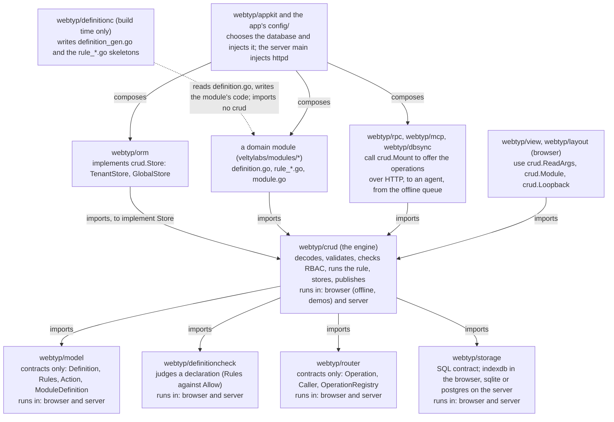

# Where `webtyp/crud` sits in the framework

This diagram answers one question: who `crud` depends on, who depends on it, and in which binary each piece runs. It is drawn from the `go.mod` files and imports of the repos, not from memory;
when a repo starts or stops importing `crud`, this file changes in the same plan. No test walks it; the check is `grep -l 'webtyp.com/crud' */go.mod`.

1. `crud` imports only contracts (`model`, `router`, `storage`) and the judge; it imports no database driver, no `httpd` and no UI.
2. `orm` imports `crud` to implement its `Store`; `crud` never imports `orm`, so the database is chosen by the app.
3. A domain module imports `crud` for the types its rules use (`CurrentUser`, `Tx`, `RuleAnswer`); `definitionc` writes the glue and never imports it.
4. `rpc`, `mcp` and `dbsync` are the three ways an operation reaches `crud`; each calls `crud.Mount` on a module and none re-implements validation.
5. `view` and `layout` run in the browser and use `crud` for the argument types and the in-process `Loopback`.
6. `appkit` and the app's `config/` are the only places that know which database, which transport and which modules exist together.
