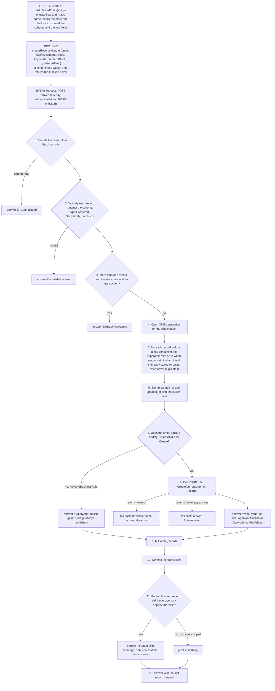

# Creating records: what happens once and what happens on every request

`createRecordsHandler` runs in two moments. At startup (`AddStoredEntity`, **once** per entity) `crud` checks the declaration and builds the function that will answer requests. On **every** `POST /api/<module>/<entity>`
that function runs from the top. The rule you write (`rule_<entity>_create.go`) is called by step 8 only. The branches are verified by `tests/stored_entity_test.go` (stage 1 of the plan).

1. Steps A and B happen **once**; the closure keeps `entity`, `events` and the field positions so no request recomputes them.
2. Steps 1 to 3 reject bad input before any database work; nothing is stored when they fail.
3. Steps 4 to 10 are one transaction: if any record fails, none of the batch is stored.
4. Only step 8 is your code; everything else is `crud`, written once for every entity.
5. Events leave at step 11, after the commit, so a rolled-back batch never announces anything.
6. The same shape, with its own differences, serves update (`updateRecordsHandler`: only the sent fields change, `old` and `next` reach the rule) and delete (`deleteRecordsHandler`: the stored row reaches the rule).
