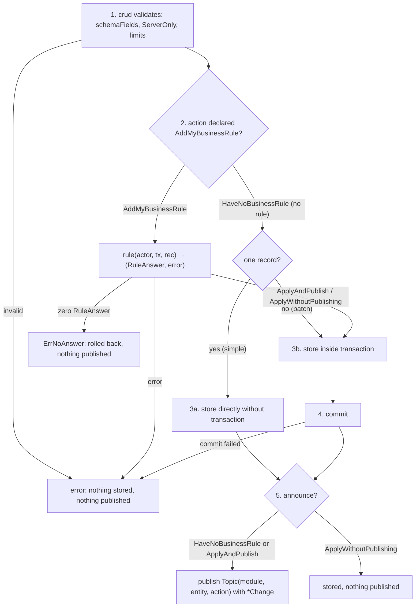

# Write Flow: Validation, Rules, Commit, and Post-Commit Publishing

This diagram describes the execution flow for write operations (create, update, delete) in `webtyp/crud`.
It is read by module authors writing business rules and by developers auditing transactional boundaries and event publishing.

## Walkthrough

1. **1. Validates:** `crud` validates the incoming payload against declared `schemaFields`, ensures `ServerOnly` fields are untouched, and checks pagination and ID limits. Any violation returns immediately without touching storage or publishing.
2. **2. AddMyBusinessRule / HaveNoBusinessRule:** Checks whether the entity's model definition declares `AddMyBusinessRule` or `HaveNoBusinessRule` for the action. Plain storage (`HaveNoBusinessRule`) of a single record runs directly without a transaction (`simple`, a single statement is atomic by itself). A rule always gets a transaction so its check and its write remain one unit.
3. **3. The rule's RuleAnswer:** When `AddMyBusinessRule` is declared, the connected rule executes inside the transaction: `rule(currentUser, tx, rec)` returning `(RuleAnswer, error)`. Any returned error rolls back the batch.
4. **4. Zero-result refusal:** A rule returning a zero `RuleAnswer` without an error is rejected with `ErrNoAnswer`; the transaction rolls back and nothing is published.
5. **5. Store:** `crud` persists records via the configured `Store` (directly when simple, or inside the active transaction).
6. **6. Commit:** For transactional writes, the transaction is committed. If commit fails, the operation errors out and nothing is announced. A simple write has no transaction to commit.
7. **7. Announce or silent:** If the action was `HaveNoBusinessRule` or the rule answered `ApplyAndPublish`, an event is queued for delivery. If the rule answered `ApplyWithoutPublishing`, data is stored silently.
8. **8. Publish Topic with *Change:** Only after successful write or commit, `crud` publishes an `events.Event` to `Topic(module, entity, action)` with payload `*crud.Change{Record: ..., Fields: ...}`.
9. **9. Conditional Updates & Revision (D48):** When an entity declares a `Revision` field, `create` initializes it to 1. On `update`, the client cannot write the revision directly in `fields` (`ErrInvalidField`) and must provide the revision read in `Record` (`expected > 0`, or `ErrRevisionRequired`). `crud` increments the revision (`expected + 1`), appends it to fields, and calls `ConditionalUpdater.UpdateFieldsIf`. If 0 rows were updated (stale write), the update fails with `ErrConflict` (409). Any unique constraint violation is reported as `ErrAlreadyExists` (409).
